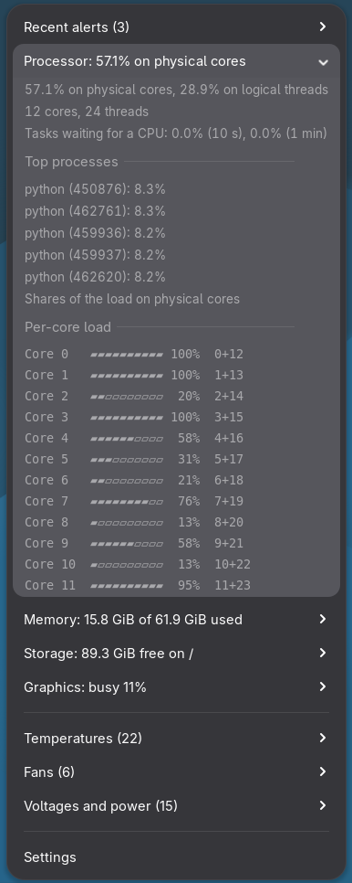
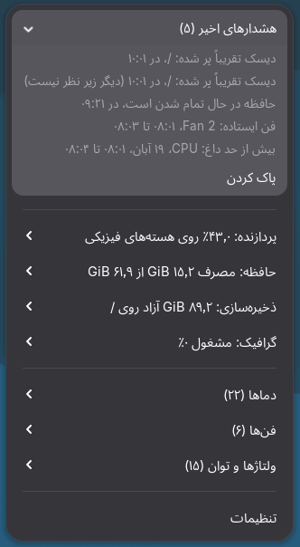
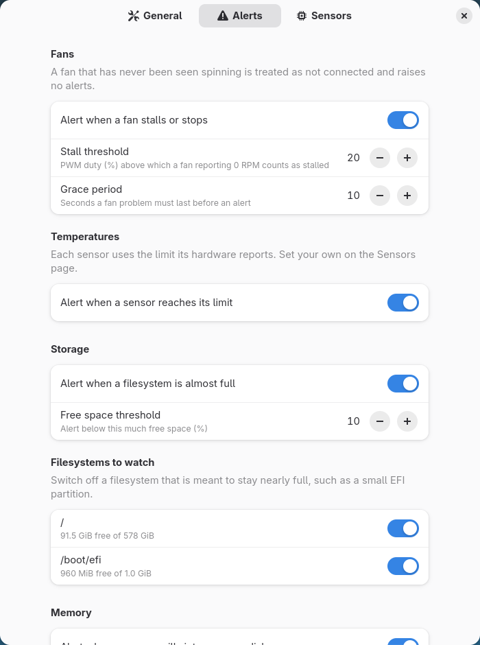

# Core Sentinel

Honest system load and hardware health for the GNOME Shell top bar.


Most monitors answer *"how busy is the machine?"* with an average over logical
CPUs and a "used memory" figure that counts page cache. Core Sentinel answers
two better questions:

- **What is actually limiting my machine right now?** CPU load over *physical*
  cores, and kernel pressure (PSI) for CPU, memory and I/O.
- **Is the hardware healthy?** Every hwmon sensor, with alerts for stalled or
  stopped fans, hot components, nearly full disks, memory spilling to disk and
  thrashing.

| Menu | Persian (RTL) | Preferences |
|---|---|---|
|  |  |  |

## Features

The menu has one row per group (processor, memory, storage, graphics,
temperatures, fans, voltages), whose title sums it up and turns red while one
of its alerts is on; a click opens the group's details below it.

- **Physical-core CPU load.** SMT sibling threads are merged using the kernel's
  topology, so twelve busy cores on a 24-thread CPU read 100%, not 50%. The
  logical average and a per-core breakdown are in the menu.
- **Pressure (PSI)** for CPU, memory and I/O, shown as three dots in the top bar
  and as numbers in the menu.
- **Memory** used without reclaimable page cache; zram (with its compression
  ratio) and swap on disk shown apart.
- **The processes behind the load.** The Processor group lists the five
  busiest processes by CPU and the Memory group the five with the most private
  memory, each with its process ID, so when the pressure dots say CPU or memory
  is the bottleneck, the menu says who.
- **Storage**: free space per filesystem, read/write throughput and busy time
  per disk.
- **GPU** (AMD, via `amdgpu`): load, VRAM, temperature, fan and board power. A
  GPU in runtime suspend is never read, so a laptop dGPU is not woken up.
- **Sensors**: every temperature, fan (with PWM duty), voltage and power
  channel the kernel exposes, grouped by device.
- **Alerts** as desktop notifications, with grace periods and hysteresis so a
  reading hovering at a limit raises one alert, not a stream:
  - a fan driven above a PWM threshold that reports 0 RPM (stalled), or a fan
    that was spinning and stopped;
  - a fan slower than a minimum you set;
  - a sensor at its temperature limit (the hardware's own limit by default);
  - a filesystem almost full (each filesystem can be left out, for one that is
    meant to stay nearly full, such as a small EFI partition); memory spilling
    into swap on disk; thrashing;
  - optionally, CPU saturation and I/O bottlenecks.
- **Keeps watching while the screen is locked.** A fan that stops while you are
  away still raises its alarm, shown on the lock screen, and an alert that is
  still on is not announced again at every unlock. The top-bar button itself is
  hidden on the lock screen.
- **Recent alerts** in the menu: the last 20 alerts with when each began and
  ended (*Fan stopped: Fan 2, 03:12 to 03:14*), or *since* when for one still
  on, so after unlocking you see what happened while you were away. Times
  follow the top-bar clock (24- or 12-hour). Kept in memory only, so it
  starts afresh when GNOME Shell restarts.
- **Unconnected fan headers are recognised.** A fan never seen spinning is shown
  as *not connected* and raises no alerts. Once seen spinning it is remembered,
  so a fan that dies before you log in is still caught.
- **Per-sensor settings**: rename, hide, set a minimum RPM or a temperature limit,
  mark a fan as zero-RPM.
- Translations: English, Persian. Numbers follow your locale (Persian digits
  in Persian, a decimal comma in German).

## Requirements

- GNOME Shell 48, 49, 50 or 51. A new GNOME version is added once the
  extension has been tested on it; until a release lists it, the Extensions app
  shows Core Sentinel as out of date and will not switch it on.
- Sensor drivers loaded for your hardware. Run `sensors` (from `lm-sensors`):
  whatever it lists, Core Sentinel shows. Many desktop boards need a Super I/O
  driver for fans and voltages, for example `it87` on Gigabyte boards
  (`modprobe it87 ignore_resource_conflict=1`) or `nct6775` on ASUS and MSI.

## Install

From extensions.gnome.org (coming soon), from a
[release](https://github.com/mehdashti/core-sentinel/releases):

```sh
gnome-extensions install --force core-sentinel@mehdashti.github.io.shell-extension.zip
```

or from source:

```sh
git clone https://github.com/mehdashti/core-sentinel.git
cd core-sentinel
make install
```

Then log out and back in (Wayland) and enable *Core Sentinel* in the Extensions app.

## How it measures

| Figure | Source | Notes |
|---|---|---|
| Physical-core load | `/proc/stat`, `/sys/devices/system/cpu/cpu*/topology` | A core's load is `min(100, sum of its threads)`. Linux places tasks on idle physical cores before doubling up on siblings, so overlap is rare until every core is busy anyway. |
| Pressure | `/proc/pressure/{cpu,memory,io}` | *some*: at least one task stalled; *full*: all non-idle tasks stalled. Dots: green below 5%, yellow below 25%, red above (10 s average of *some*). |
| Memory used | `/proc/meminfo` | `MemTotal − MemAvailable`, the kernel's own estimate of what can be handed out without swapping. |
| zram / swap | `/proc/swaps`, `/sys/block/zram*/mm_stat` | Swap on disk is where slowdowns begin; zram is compressed RAM. |
| Disk I/O | `/proc/diskstats` | Whole disks only; busy is the share of time with I/O in flight. |
| Process CPU | `/proc/[pid]/stat`, `/proc/stat` | A process (all its threads together) gets its part of the physical-core load: its CPU time over the busy time of all CPUs between two readings. The shares add up to the top-bar figure, less the time spent on interrupts, which no process owns. While cores are idle, one busy thread is one core: 8% on a 12-core CPU. Kernel threads are shown in brackets, `[kswapd0]`. |
| Process memory | `/proc/[pid]/status` | Private memory in RAM (`RssAnon`). Shared memory is left out: a database's shared buffers would count again in each of its processes. Read only for the few processes whose resident size could still place them in the list. |
| Sensors | `/sys/class/hwmon` | Keyed by driver and device address (`it8689@it87.2624/fan1`, `nvme@0000:02:00.0/temp1`), never by a number handed out in probe order (`hwmonN`, `nvme0`, `phy0`, an i2c bus), which can change between boots. |
| Temperature limits | `tempN_crit`, then `tempN_max` | Implausible values (0, 127, 255 °C) are ignored. A heat alert ends 5 °C below the limit. |
| Fan stall | `fanN_input`, `pwmN` | 0 RPM while the duty cycle is at or above the stall threshold (20% by default) for the grace period (10 s). |

Everything is read asynchronously from `/proc` and `/sys` every two seconds (configurable).
A file that stops answering (a hung driver, a dying disk) reads as unavailable
until it answers again; it never freezes the other readings.
The process lists are read only while the Processor or Memory group is open,
every two seconds, one file per process and at most four at a time; on a
Ryzen 9 7900X one reading of about 900 processes costs the shell about 35 ms
of CPU time, in small pieces between frames.
Per-process disk I/O is not shown: the kernel shows it to a user only for
their own processes, and I/O bottlenecks are often caused by system services
that such a list would leave out.
Core Sentinel uses no network and starts no helper processes.

## Development

```sh
make test         # unit tests (gjs)
make lint         # ESLint
make snapshot     # print what the data layer sees on this machine, and how
                  # long one reading and one process list take
tools/shell-test.sh OUT_DIR [LOCALE]
                  # run the extension in an isolated headless GNOME Shell:
                  # screenshots of the panel, the menu with each group open, a
                  # notification and each preferences page; report.json checks
                  # lock/unlock, alerts and how much of each open group shows;
                  # prints PASS, or what failed and exits 1 (needs jq; it runs
                  # the GNOME Shell installed on this machine)
make install-dev  # symlink the working tree as the installed extension
make pot          # refresh po/core-sentinel.pot and merge into the .po files
make pack         # build dist/core-sentinel@mehdashti.github.io.shell-extension.zip
```

`src/lib/` holds everything that does not need GNOME Shell: data readers, the
alert rules, labels and formatting. It is shared by the shell (`extension.js`),
the preferences window (`prefs.js`) and the tests. `src/ui/` is shell-only.

### Continuous integration

Every push runs the lint, the unit tests and the bundle build, and
`tools/shell-test.sh` (in English and in Persian) in a container with the
GNOME Shell of the newest stable Fedora. Every Monday, and when started by hand
(Actions, CI, Run workflow), the shell test runs on Fedora rawhide too: the
GNOME Shell to come. Each run keeps its screenshots and `shell.log` as an
artifact. When rawhide reaches a GNOME major that `shell-version` in
`src/metadata.json` does not list, that run fails and says so: the time to add
it, before users upgrade.

The container test on your machine, as CI runs it (Docker):

```sh
docker run --rm -v "$PWD:/src" -w /src quay.io/fedora/fedora:rawhide bash -c \
    'tests/shell/container.sh && runuser -u tester -- env XDG_SESSION_ID=c1 tools/shell-test.sh out'
```

### Releases

Set `version-name` in `src/metadata.json`, then push a matching tag (`v0.2.0`).
CI runs the checks and publishes the bundle as a GitHub release.

### Translations

Copy `po/core-sentinel.pot` to `po/<language>.po`, translate, and open a pull
request. Keep the `%s` and `%d` placeholders in their original order.

## License

GPL-2.0-or-later. See [LICENSE](LICENSE).
